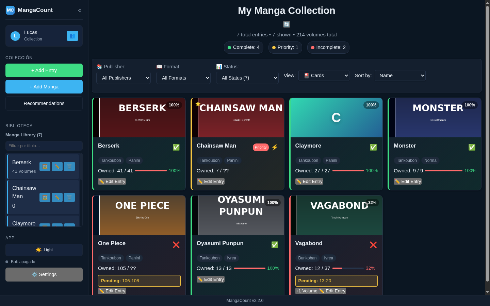
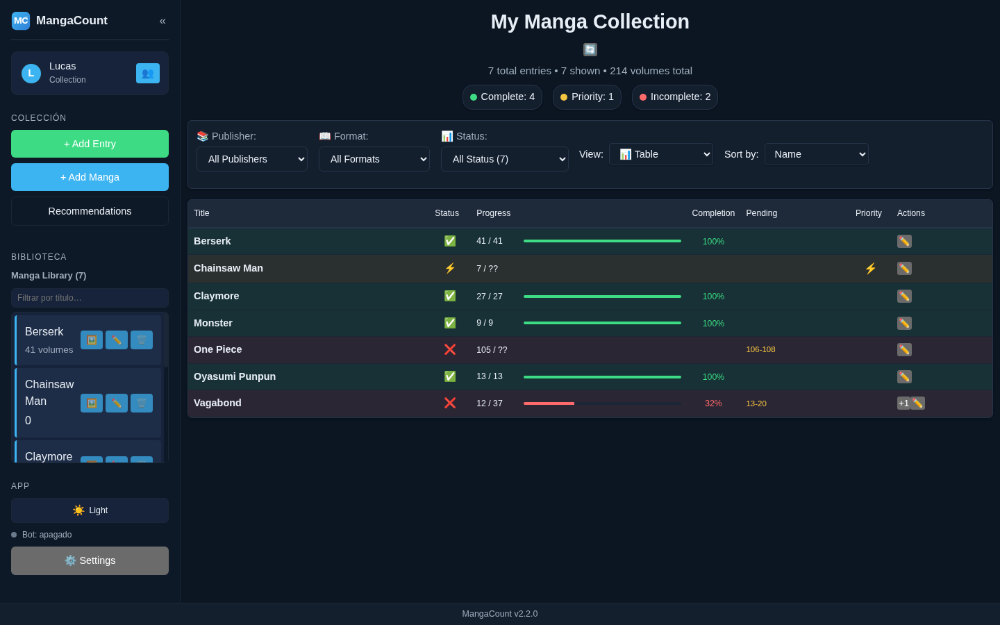
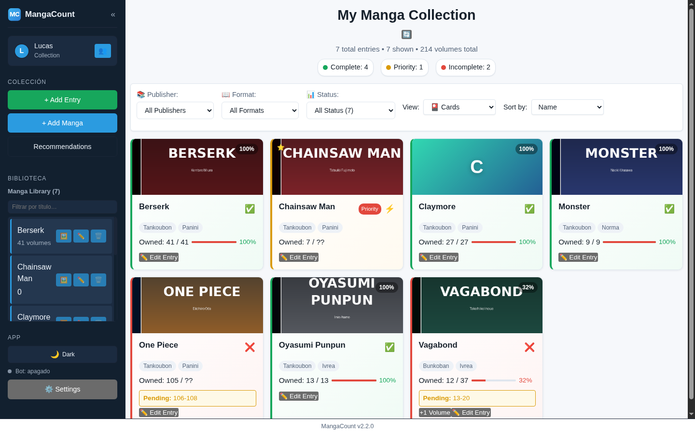
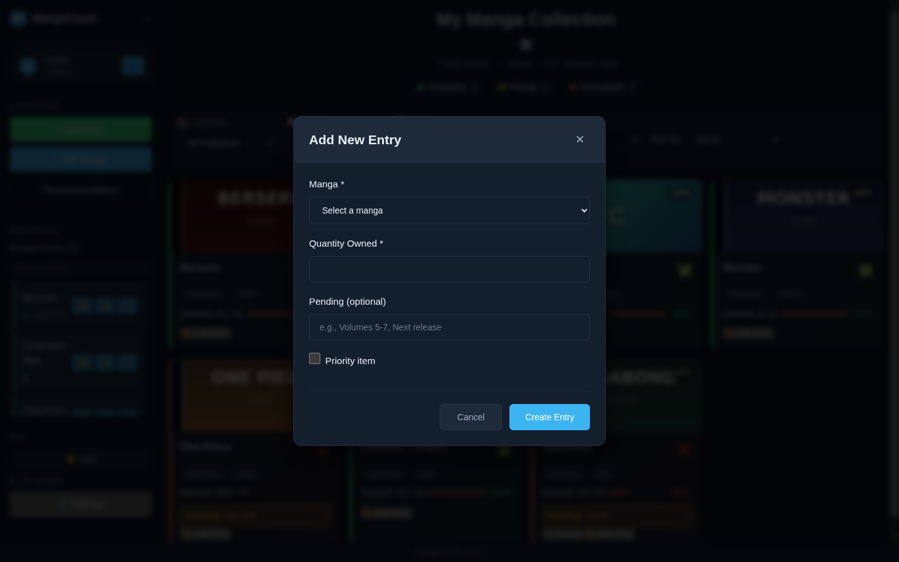
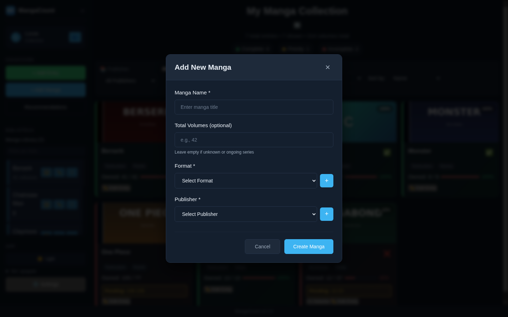
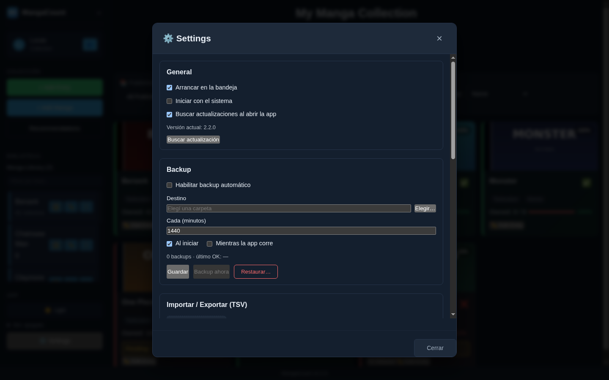
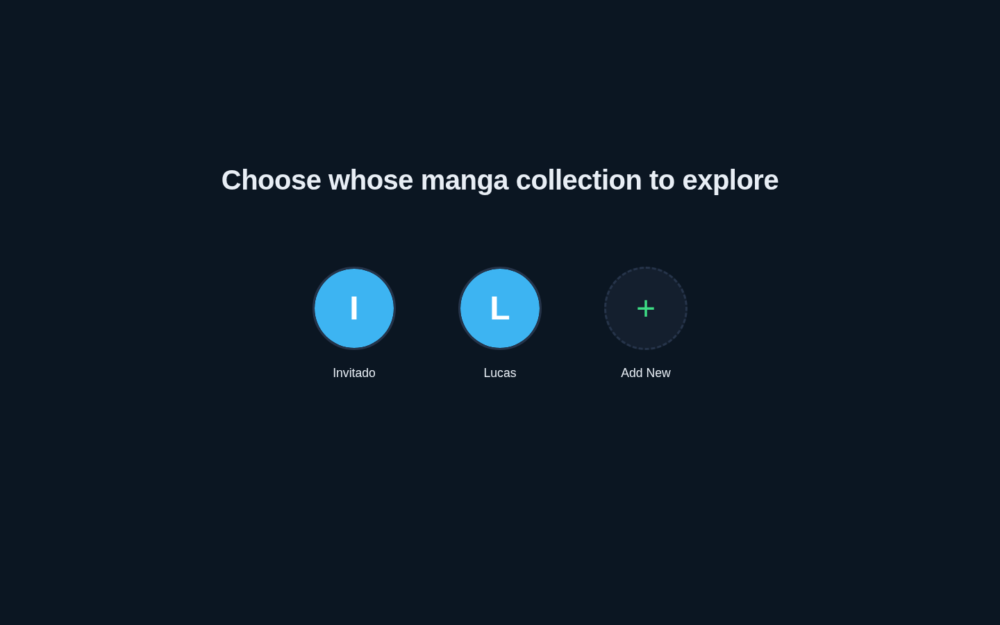

# MangaCount

**Gestor de colección de manga para escritorio, local-first.**

[](https://github.com/Lubonch/MangaCount/actions/workflows/test.yml)
[](https://github.com/Lubonch/MangaCount/actions/workflows/audit.yml)
[](https://github.com/Lubonch/MangaCount/releases/latest)
[](LICENSE)
[](#descargar-e-instalar)
[](#desarrollo)

<p align="center">
  
</p>

MangaCount organiza tu colección de manga en una aplicación de escritorio autocontenida:
**Electron** para el proceso principal, **React + Vite** para la interfaz y **SQLite embebida**
para los datos. No hay servidor, ni base de datos externa, ni cuenta en la nube: todo vive en tu
equipo. El renderer consume los datos por IPC a través de un proceso main que porta la lógica de
negocio a Node.

## Características

### Colección

- **Múltiples perfiles**, cada uno con su propia colección y foto de perfil.
- **CRUD de mangas y entries** con volúmenes comprados, pendientes, prioridad y progreso por serie.
- **Búsqueda en la Biblioteca** del sidebar y filtros por editorial, formato y estado.
- **Tres vistas**: tarjetas con portada, tabla y compacta; orden por nombre, progreso, cantidad,
  prioridad, editorial o formato.
- **Importación y exportación TSV** de la colección.
- **Recomendaciones** de series no poseídas con un motor local (`shared/recommendations`).

### Portadas

- **Búsqueda en AniList sin API key**, con caché local de las imágenes.
- **Portadas locales** desde el equipo, validadas por *magic bytes*.
- **Portada generada** (gradiente + iniciales) para las series sin imagen.
- **Blur y badge `+18`** en portadas adultas, con revelado configurable (hover o click).

### Datos y sistema

- **SQLite local** con migraciones versionadas y estado inicial vacío.
- **Backup y restore** del sistema completo en `.zip` (base + fotos), con backup automático opcional.
- **App residente en la bandeja** con autostart opcional: cerrar la ventana no cierra la app.
- **Diagnóstico** con logs rotativos, copia del diagnóstico al portapapeles y apertura de la carpeta
  de logs desde Settings.

### Integraciones

- **Bot de Discord embebido** (opcional) para consultar y editar la colección desde Discord.
- **Chequeo de actualizaciones** en el footer: en Windows y AppImage la app descarga e instala sola;
  en `.deb` y `makepkg` (Arch) enlaza a la release de GitHub.

### Interfaz

- Temas **claro/oscuro** (oscuro por defecto) sobre design tokens, tipografía **Inter** y logo propio.
- **Sidebar colapsable** y pantalla de **Settings** que reúne configuración, backup, intercambio TSV,
  bot y diagnóstico.

## Capturas de pantalla

| Vista tabla | Tema claro |
| --- | --- |
|  |  |

| Alta de entry | Alta de manga |
| --- | --- |
|  |  |

| Settings | Selector de perfiles |
| --- | --- |
|  |  |

## Descargar e instalar

Los instaladores se publican en **[GitHub Releases](https://github.com/Lubonch/MangaCount/releases)**
para cada tag `v*`:

- **Windows**: `MangaCount.Setup.<version>.exe` (instalador NSIS)
- **Debian / Ubuntu**: `mangacount_<version>_amd64.deb`
- **Arch y otras distros**: `MangaCount-<version>.AppImage`

```bash
# Debian / Ubuntu
sudo apt install ./mangacount_<version>_amd64.deb

# AppImage
chmod +x MangaCount-<version>.AppImage
./MangaCount-<version>.AppImage
```

> El `.exe` no está firmado con un certificado de pago: Windows SmartScreen puede advertir. Elegí
> *Más información → Ejecutar de todas formas*.
>
> Si el AppImage no arranca por falta de FUSE: `./MangaCount-<version>.AppImage --appimage-extract-and-run`
> o instalá `libfuse2`.

### Arch Linux y derivadas (makepkg)

El repo incluye [`packaging/arch/PKGBUILD`](packaging/arch/PKGBUILD), que reempaqueta el AppImage
publicado e integra la app en el sistema (binario en `/usr/bin`, lanzador de escritorio e iconos),
sin depender de FUSE:

```bash
sudo pacman -S --needed base-devel git   # makepkg no se corre como root
git clone https://github.com/Lubonch/MangaCount.git
cd MangaCount/packaging/arch
makepkg -si
```

`makepkg` descarga el `MangaCount-<version>.AppImage` del release `v<version>` y lo instala como el
paquete `mangacount`. Para actualizar, cambiá `pkgver` en el `PKGBUILD` y regenerá checksums con
`updpkgsums`. Desinstalar: `sudo pacman -R mangacount`.

## Datos de la app

Todo vive en la carpeta `userData` del sistema, fuera del bundle:

- Windows: `%APPDATA%\mangacount\`
- Linux: `~/.config/mangacount/`

| Archivo / carpeta | Contenido |
| --- | --- |
| `mangacount.db` (+ `-wal`, `-shm`) | Base SQLite con perfiles, mangas, entries, formatos y editoriales |
| `profiles/` | Fotos de perfil, servidas al renderer por `mangacount://profiles/<archivo>` |
| `covers/` | Caché de portadas (AniList y locales) |
| `logs/` | `app.txt` con rotación diaria (`app.YYYY-MM-DD.txt`) |
| `preferences.json` | Preferencias de tray, backup y bot |
| `discord-token.bin` | Token del bot cifrado con `safeStorage` |
| `backups-restore/` | Backups de seguridad previos a un restore |

Detalles de esquema, backup, tray/autostart, bot y troubleshooting por plataforma:
[`docs/desktop.md`](docs/desktop.md).

## Bot de Discord (opcional)

MangaCount puede exponer la colección por un bot **embebido** en la app (arranca y se detiene con
ella, sobre la misma base local). Permite consultar y editar la colección:

- **Consulta**: `/perfil`, `/buscar`, `/pendientes`, `/recomendar`.
- **Edición**: `/tomo` (+1 volumen), `/actualizar` (fijar cantidad), `/pending` (tomos no
  consecutivos), `/prioridad` (activar/desactivar), `/nuevo` (crear manga + entry en 0) y `/ayuda`.

Las operaciones de edición piden **confirmación** (botones Confirmar/Cancelar) y solo las puede usar
alguien de la allowlist. Si el título coincide con 0 o más de una serie, el bot no escribe y pide
desambiguar.

**Cada usuario usa su propio bot**: su aplicación de Discord, su token y su servidor. La app no usa
el *Application ID* en runtime; solo lo necesitás una vez para armar la URL de invitación.

Pasos (una vez por usuario):

1. **Crear la aplicación**: en el [Discord Developer Portal](https://discord.com/developers/applications)
   → *New Application*. Copiá el **Application ID** de *General Information*.
2. **Token**: pestaña *Bot* → *Reset Token* → copiar. Guardalo en un gestor de secretos (nunca en el
   repo ni en el chat).
3. **Invitar el bot** con el Application ID:
   `https://discord.com/api/oauth2/authorize?client_id=<APPLICATION_ID>&permissions=83968&scope=bot%20applications.commands`
   (83968 = *Send Messages* + *Embed Links* + *Read Message History*).
4. **Guild ID y User ID**: activá *Modo desarrollador* en Discord (Configuración → Avanzado) y copiá
   el ID del servidor y el de tu usuario.
5. **Configurar en la app**: ⚙️ **Settings → Bot**: Token, Guild ID y *Usuarios permitidos* → *Habilitar
   bot* → *Guardar*. El estado debe quedar **conectado**.

## Desarrollo

Requisitos: **Node.js 20+** y npm. La CI corre sobre Node 22.

```bash
npm ci
npm ci --prefix mangacount.client
```

### Modo desarrollo (Electron + hot-reload)

En una terminal:

```bash
npm run dev            # Vite en http://localhost:5173
```

En otra:

```bash
MANGACOUNT_DEV_URL=http://localhost:5173 npx electron .
```

El proceso main abre la ventana apuntando al dev server y expone los canales IPC a través del
preload. El modo soportado es Electron.

### Build y empaquetado

```bash
npm run build:renderer   # build del renderer (mangacount.client/dist)
npm run dist             # build:renderer + electron-builder (según el OS)
npm run dist:linux       # .deb + .AppImage
npm run dist:win         # .exe (NSIS)
```

`electron-builder` reconstruye el módulo nativo `better-sqlite3` para el ABI de Electron. Si después
necesitás correr los tests bajo Node, reconstruilo para Node:

```bash
npm run rebuild:node
```

## Tests

```bash
npm test                                      # proceso main (node --test)
npm run test:renderer                         # renderer (vitest)
npm run test:renderer:coverage                # renderer + cobertura
npm run lint:renderer                         # ESLint del renderer
```

La CI (`.github/workflows/test.yml`) exige **cobertura ≥ 90%** en main y renderer, y corre además
`npm audit` (`.github/workflows/audit.yml`).

## Publicar una release

El workflow [`release.yml`](.github/workflows/release.yml) compila los instaladores en runners
Windows y Linux y crea un GitHub Release **draft** con los artefactos:

```bash
git tag vX.Y.Z
git push origin vX.Y.Z
```

También se puede disparar manualmente desde *Actions* (`workflow_dispatch`) para generar solo los
artefactos, sin release. El `.exe` no se cross-compila: se genera en el runner Windows.

## Migrar desde una instalación con servidor (PostgreSQL)

Si venías usando la versión cliente-servidor, hay un script de traspaso único que copia las 5 tablas
(perfiles, mangas, entries, formatos y editoriales) de PostgreSQL a la SQLite local y verifica
conteos, la constraint `UNIQUE(ProfileId, MangaId)`, que no se descarten filas y un spot-check de 20
entries.

Requisitos: app **cerrada**, `npm ci` en la raíz (el script usa `pg`) y, de ser posible, la base
PostgreSQL en solo lectura.

```bash
PG_CONNECTION_STRING="Host=localhost;Database=MangaCount;Username=mangacount;Password=***;Port=5432" \
  node electron/main/db/migrate-from-postgres.js "<carpeta-de-datos>"
```

`<carpeta-de-datos>` es la de `userData` (ver [Datos de la app](#datos-de-la-app)). El script falla
con código ≠ 0 ante cualquier diferencia para no dejar una migración a medias.

## Estructura

```text
MangaCount/
├── electron/               # proceso main: SQLite, handlers IPC, servicios, preload
│   ├── main/
│   │   ├── db/             # esquema, cliente SQLite y repositorios
│   │   ├── ipc/            # handlers por canal
│   │   └── services/       # portadas, backup, bot, updater, prefs, logs
│   └── assets/             # iconos de la app y del tray
├── mangacount.client/      # renderer React + Vite (adaptador IPC en src/api)
├── shared/recommendations/ # motor de recomendaciones compartido (JS)
├── docs/                   # documentación desktop y capturas
├── packaging/arch/         # PKGBUILD para Arch Linux
├── scripts/                # utilidades de release
└── aspec/                  # specs y changes (spec-driven)
```

> El backend .NET/PostgreSQL queda fuera del alcance de la app de escritorio. El antiguo bot de
> WhatsApp se eliminó del repo: lo reemplaza el bot de Discord embebido en el proceso main.

## Contribuir

Los cambios se documentan con el flujo **aspec** en `aspec/changes/` (proposal, design, tasks y delta
specs). Antes de abrir un PR:

```bash
npm test
npm run test:renderer:coverage
npm run lint:renderer
npm run build:renderer
```

### Protocolo de rama

`main` es la rama de release y **solo se actualiza por PR desde `develop`**:

- No se pushea directo a `main` (tampoco force-push ni borrado).
- Los PRs hacia `main` **deben** tener `develop` como rama de origen: el workflow
  [`branch-enforcement.yml`](.github/workflows/branch-enforcement.yml) falla si no.
- El merge exige los checks de CI en verde (`Tests`, `Dependency Audit`) y el check
  `Require develop source`.
- El flujo normal es: trabajar en una rama → mergear a `develop` → PR `develop → main` → release.

**Hotfix**: si hiciera falta saltear el protocolo, se desactiva el ruleset **“PR only”** en
*Settings → Rules* (acción manual y excepcional) y se vuelve a activar al terminar.

## Licencia

MIT. Ver [`LICENSE`](LICENSE).
